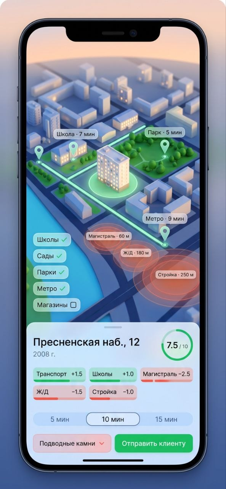
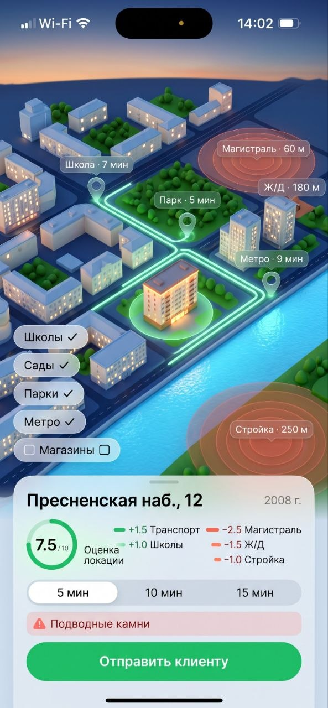
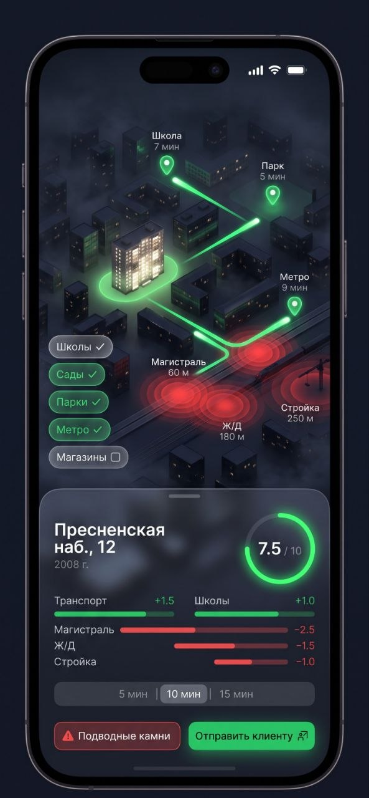

# Макеты: что к чему (навигатор)

Дата: 2026-11-20. Файлы в этой папке — из разных итераций, они не сходятся
между собой. Это нормально: часть — цель, часть — опора, часть — архив.
При разговоре о визуале ссылаемся на эту таблицу, а не на «картинку,
которую кто-то помнит».

## Сейчас, коротко

- **Цель:** `card-diorama-day.png` и `card-diorama-evening.png` — светлая
  и вечерняя пастельная диорама. У `card-dark-neon.png` берём только свет
  и контраст; HUD-неон в продуктовый UI не тащим.
- **Опора:** `card-light.png` (карточка, шторка, чипы) и
  `card-dark-city.png` (читаемость тёмной темы).
- **Архив/маркетинг:** `concept-hud-*` — только промо, не продукт.
- **Правило:** в задаче по визуалу пишем файл-ориентир, например
  «делаем как в `card-diorama-day.png`».

## Три целевых макета

| День — основа | Вечер — настроение | Тёмный неон — только свет |
|---|---|---|
|  |  |  |

## Куда идём (целевое настроение)

| Файл | Статус | Что берём |
|---|---|---|
| `card-diorama-day.png` | **ЦЕЛЬ** | Основной светлый продуктовый вид: пастельная диорама, мягкий свет, семафорная зелень/красность |
| `card-diorama-evening.png` | **ЦЕЛЬ** | Вечерняя подача: свет, тени, настроение |
| `card-dark-neon.png` | **ЦЕЛЬ (настроение)** | Тёмный неон как ориентир по свету и контрасту; в продукт переносим аккуратно (см. оговорку) |

**Оговорка про неон.** SPEC §4 фиксирует: неоновый HUD — стиль для
маркетинга, не для продуктового UI (читаемость и средний Android). Поэтому
из `card-dark-neon.png` берём настроение и свет, а HUD-элементы (сетки,
яркие обводки, «киберпанк») в продукт не тащим без отдельного решения
владельца.

## Опора для текущих тем

| Файл | Статус | Что берём |
|---|---|---|
| `card-light.png` | Опора | Светлая тема: карточка, шторка, чипы |
| `card-dark-city.png` | Опора | Тёмная тема: контраст, читаемость на улице |

## Архив и маркетинг (не продуктовый UI)

| Файл | Статус | Где использовать |
|---|---|---|
| `concept-hud-moscow-map.png` | Архив/маркетинг | Reels/Shorts, промо-кадры |
| `concept-hud-eco-energy.png` | Архив/маркетинг | Reels/Shorts, промо-кадры |

## Правила

1. Макеты не удаляем. Статус меняется строкой в этой таблице и записью в
   `docs/decisions.md`.
2. Обсуждая визуал, сначала называем файл из таблицы: «делаем как в
   `card-diorama-day.png`», а не «как на том макете».
3. Если макет противоречит SPEC §4 (неон в продукте) — действует SPEC,
   пока владелец явно не изменит решение.
4. Новые макеты добавляем сюда же, в одну из трёх групп.
